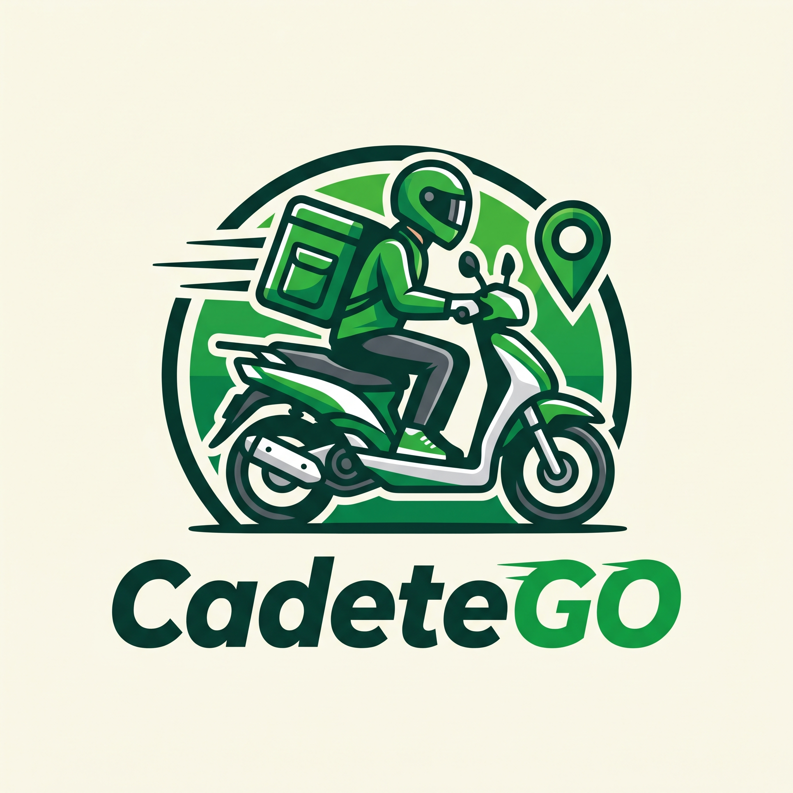

  

# CadeteGO 🛵

**Proyecto Final - Evaluación Integradora Unidad 4 (Desarrollo de Software)**

CadeteGO es una aplicación móvil desarrollada como Producto Mínimo Viable (MVP) para optimizar la logística de entregas de comercios locales. Permite a los repartidores visualizar sus rutas, cambiar el estado de los pedidos y gestionar sus despachos sin depender de mensajería informal.

## 📌 Avances - Hito 1 y 2 (04/11)

Durante esta etapa se establecieron las bases tecnológicas, la arquitectura de la interfaz y la conexión al backend remoto:

- ✅ **Elección Tecnológica y Entorno:** Configuración inicial del proyecto multiplataforma utilizando **Flutter (Dart)**.
- ✅ **Arquitectura de Interfaz:** Modularización del código base implementando buenas prácticas (separación de la lógica y la UI en la carpeta `/screens`).
- ✅ **Desarrollo UI (Primeras Pantallas):**
  - `LoginScreen` y `RegisterScreen` (con validación de formularios mediante `FormState`).
  - `HomeScreen` (Dashboard simulado de pedidos).
  - `DetalleScreen` (Vista profunda de la orden).
  - `PerfilScreen` (Gestión de sesión).
- ✅ **Integración de Backend y Base de Datos:**
  - Configuración inicial de **Supabase** (PostgreSQL).
  - Implementación del paquete `supabase_flutter`.
  - Conexión exitosa del servicio de Autenticación (`auth.signUp` y `auth.signInWithPassword`), incluyendo el envío de correos de confirmación.

## 📌 Avances - Hito 3 (MVP Final y Reglas de Negocio)

En esta etapa final se completó el flujo operativo en tiempo real, las reglas de negocio entre roles, la integración nativa con GPS y el soporte offline:

- ✅ **Identidad Visual:** Diseño e integración del logo oficial de **CadeteGO** en las pantallas de inicio de sesión y registro.
- ✅ **Arquitectura Dual de Roles y Automatización en BD:**
  - Registro dinámico según perfil (**Comercio/Local** o **Cadete**), solicitando rubro y dirección comercial en caso de ser local.
  - Automatización en PostgreSQL mediante **Triggers** (`handle_new_user`) para sincronizar `auth.users` con la tabla `public.perfiles` y redirección inteligente al iniciar sesión.
- ✅ **Dashboard y Métricas para Comercios (`HomeLocalScreen`):**
  - Tarjetas KPI en tiempo real con el **total recaudado ($)**, cantidad de **pedidos activos** y **entregados**.
  - Carga de nuevos envíos con dirección, monto y observaciones.
  - **Sistema de reputación:** Calificación de 1 a 5 estrellas (⭐) al cadete una vez completada la entrega.
- ✅ **Operativa del Cadete, GPS y Modo Offline (`HomeCadeteScreen`, `DetalleScreen`, `PerfilScreen`):**
  - **CRUD completo en tiempo real:** Gestión de estados `Pendiente` → `En camino` → `Entregado` / `Cancelado` (con registro obligatorio del motivo).
  - **Reglas de negocio y alertas:** Notificación visual de pedidos disponibles y bloqueo preventivo que impide tomar nuevos envíos hasta finalizar el pedido activo en curso.
  - **Integración nativa con GPS:** Apertura directa de Google Maps en modo navegación para motocicleta (`travelmode=motorcycle`) mediante `url_launcher`.
  - **Persistencia local (Modo Offline):** Almacenamiento en caché JSON mediante `shared_preferences` para visualizar los pedidos ante cortes de conectividad.
  - **Perfil dinámico:** Cálculo del promedio de estrellas obtenidas, contador de entregas completadas y cierre seguro de sesión.
- ✅ **Seguridad:** Protección de credenciales de Supabase mediante variables de entorno (`.env`).

## 🛠️ Tecnologías utilizadas

- **Frontend:** Flutter & Dart (Material Design)
- **Backend as a Service:** Supabase (PostgreSQL, Auth, Realtime Streams y Triggers PL/pgSQL)
- **Persistencia Local y Hardware:** `shared_preferences` (caché offline), `url_launcher` (GPS/Google Maps), `flutter_dotenv`
- **Control de Versiones:** Git & GitHub

## 🚀 Cómo ejecutar el proyecto

1. Clonar el repositorio: `git clone https://github.com/Kelany29/CadeteGo.git`
2. Configurar variables de entorno: Crear un archivo `.env` en la raíz del proyecto con las claves `SUPABASE_URL` y `SUPABASE_ANON_KEY`.
3. Instalar las dependencias: `flutter pub get`
4. Ejecutar en emulador, dispositivo físico o Chrome: `flutter run`

Desarrollado por Kelany Blanco (@Kelany29) — Tecnicatura Superior en Desarrollo de Software.
